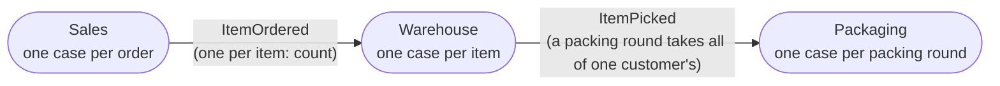

# Order Management example

An example with orders, items and packages, to show the multi-process features working together on a
realistic model: three processes, seven people on one calendar, and two catalogues, for its customers and
products. The models are in `testing_scripts/assets/order_management/`; the tests are in
`testing_scripts/multiprocess/examples/test_order_management.py`.

It uses most messaging features ([messaging.md](messaging.md)): one message per object with `count` and
`index`, processes started by messages, `copy`, `append` and `aggregate`, and `collect` with `same`; and the
catalogue ([catalogue.md](catalogue.md)) for its customers and products.

## The processes


```
Sales (order)        arrivals: around the clock, about one every 4.8 h, 2,000 orders
                     object attributes: customer (picked from c1..c15), items (1..16)
                     place order -> (throw ItemOrdered x items: object_id, index, customer)
                     -> confirm order (sales clerk)
                     -> XOR: 80% timer: customer pays (about 3 days) -> pay order (sales clerk) -> end
                           | 20% timer 20 days -> payment reminder (sales clerk) -> back to the XOR
Warehouse (item)     start ItemOrdered (copy order_id, item_index from index, customer)
                     object attributes: product (picked uniformly from the 20), and its weight and price
                     -> XOR: 20% item out of stock -> reorder item -> timer: item restocked | 80% straight on
                     -> pick item (warehouse worker)
                     -> message end ItemPicked{order_id, item_index, customer, object_id, weight}
Packaging (package)  arrivals: weekdays 9:00-17:00, about one packing round every 2 h, 1,450 rounds
                     -> catch ItemPicked: the oldest waiting one and every other of its customer (collect "all",
                        same customer); copy customer, append object_id to item_ids, weight = sum of their weights
                     -> create package (packer) -> send package (courier, the trip)
                     -> XOR: 80% package delivered -> end | 20% failed delivery -> send package again
                        -> XOR: 70% package delivered -> end | 30% failed delivery again
```

The customer is picked for the order and travels with the messages: order → `ItemOrdered` → item →
`ItemPicked` → package. A packing round starts in the packer's hours, takes the oldest waiting item and then all
of that customer's waiting items, and creates the package. If no item is waiting, the round waits for the next
one, and takes it with the others of its customer offered at that moment. How long an item waits for its package
therefore depends on how often rounds come, not on a drawn package size.

Rounds keep coming after the last item, and would wait forever, so their number is limited: 1,450 rounds last
until a week after the last item is picked (with seed 1 the orders end on 2024-05-08, the last item is picked on
2024-05-14 and the last round starts on 2024-05-20), so every item is packed. The rounds left over wait for an
item until the run ends: the run report lists them as stalled, and the OCEL file leaves them out (31 with seed 1).

## Who talks to whom

Every arrow goes through the orchestrator; processes never address each other. Each process is its own
consumer group, so every message goes to the one process that subscribes to its type.



## Messages

| Process       | Publishes                                                                                 | Consumes                                                                                                                                                                   |
|---------------|-------------------------------------------------------------------------------------------|----------------------------------------------------------------------------------------------------------------------------------------------------------------------------|
| **Sales**     | `ItemOrdered{object_id, index, customer}`, `count` = `items`                              | nothing                                                                                                                                                                    |
| **Warehouse** | `ItemPicked{order_id, item_index, customer, object_id, weight}`, at its message end event | `ItemOrdered` at its start event; copies `order_id` from `object_id`, `item_index` from `index`, `customer` from `customer`                                                |
| **Packaging** | nothing                                                                                   | `ItemPicked` at "items picked": `"collect": "all"` with `"same": ["customer"]`, copying `customer`, appending `object_id` to `item_ids` and summing `weight` into `weight` |

## Objects and activities

| In the OCEL output             | Process   | BPMN element                              | Feature                                                                                                |
|--------------------------------|-----------|-------------------------------------------|--------------------------------------------------------------------------------------------------------|
| object type **order**          | Sales     | one case per order                        | arrivals around the clock; object attribute `items`; `customer` picked from the catalogue              |
| object type **item**           | Warehouse | one case per item                         | a message start event on `ItemOrdered`, published once per item with `count`; `index` → `item_index`   |
| object type **package**        | Packaging | one case per packing round                | arrivals in the packer's hours; `collect` `"all"` with `same` customer; `weight` the sum of its items' |
| object type **customer**       | all       | attribute `customer`                      | 15 in the catalogue; picked for the order, copied to items and packages; what a package's items share  |
| object type **product**        | Warehouse | attribute `product`                       | 20 in the catalogue; one picked uniformly for each item, and its weight and price with it              |
| activity **place order**       | Sales     | task `Place_Order`                        | recorded by `System` when the order arrives; `ItemOrdered` is published right after it                 |
| activity **confirm order**     | Sales     | task `Confirm_Order`                      | the sales clerk                                                                                        |
| activity **payment reminder**  | Sales     | task `Payment_Reminder`                   | the 20% branch of an XOR, after a 20-day timer, then back to the XOR                                   |
| activity **pay order**         | Sales     | task `Pay_Order`                          | the 80% branch of that XOR, after the timer `Customer_Pays`: the clerk records the payment             |
| activity **item out of stock** | Warehouse | task `Item_Out_Of_Stock`                  | the 20% branch of an XOR                                                                               |
| activity **reorder item**      | Warehouse | task `Reorder_Item`                       | after item out of stock, then the timer `Item_Restocked`: the supplier's delay                         |
| activity **pick item**         | Warehouse | task `Pick_Item`                          | a warehouse worker; `ItemPicked` is published at the message end event after it                        |
| activity **create package**    | Packaging | task `Create_Package`                     | the packer, after the packing round has taken its items                                                |
| activity **send package**      | Packaging | tasks `Send_Package` and `Resend_Package` | a courier's trip: the first one, and one after each failed delivery                                    |
| activity **failed delivery**   | Packaging | task `Failed_Delivery`                    | recorded by `System`: the 20% branch after the first trip, then the 30% branch after each later one    |
| activity **package delivered** | Packaging | task `Package_Delivered`                  | recorded by `System`: the other branches, 80% after the first trip, 70% after a later one              |

## Staff, calendars and durations

Seven people do the work, on one calendar, Monday to Friday 9:00-17:00 (UTC). Durations are work time, in that
calendar, and uniform in their ranges; waiting comes from the queues, the calendar and the timers.

| Team             | People | Tasks                                      | Busy (seed 1) |
|------------------|--------|--------------------------------------------|---------------|
| Sales clerk      | 1      | confirm order, payment reminder, pay order | 21%           |
| Warehouse worker | 2      | item out of stock, reorder item, pick item | 24%           |
| Packer           | 1      | create package                             | 15%           |
| Courier          | 3      | send package                               | 64%           |

| Task                               | Work time | Who              |
|------------------------------------|-----------|------------------|
| place order                        | none      | `System`         |
| confirm order                      | 5-15 min  | sales clerk      |
| payment reminder                   | 2-5 min   | sales clerk      |
| pay order (recording the payment)  | 2-5 min   | sales clerk      |
| item out of stock                  | 1-3 min   | warehouse worker |
| reorder item                       | 5-10 min  | warehouse worker |
| pick item                          | 3-10 min  | warehouse worker |
| create package                     | 10-20 min | packer           |
| send package (the trip)            | 1-4 h     | courier          |
| failed delivery, package delivered | none      | `System`         |

The instant tasks are recorded by a `System` resource on a calendar of its own, around the clock, so they happen
when they are due: an order is placed when it arrives, and a delivery is recorded when the trip ends. `System`
isn't staff: it does nothing that takes time.

The timers run on the clock:

- **Customer pays:** exponential, mean 3 days, at most 20: how long the customer takes to pay, before the
  clerk records it. In the 80% branch the customer pays before a reminder would be due, so its maximum is the
  reminder's 20 days.
- **Reminder due:** 20 days, after the confirmation or the previous reminder.
- **Item restocked:** uniform, 3 to 7 days: the supplier's delay after a reorder.

Orders arrive around the clock, with exponential gaps of 4.8 h on average, about 35 a week, so 2,000 orders
take about 57 weeks. Packing rounds start in the packer's hours, with exponential gaps of 2 h on average; a round
that would start outside them starts when they open, so about 24 come a week.

With seed 1 the run has about 35 orders, 135 items, 27 restocks, 25 packages and 31 trips a week. The busy
shares above are the work time in the calendar over the people's hours, from the first to the last order. The
full 2,000-order run takes about 12 seconds (Apple M4 Pro).

## Running it

```
poetry run prosimos start-orchestration --config testing_scripts/assets/order_management/simulation.json \
    --log_out_path order_management_log.csv --ocel_out_path order_management_log.json
```

The configuration names the object types in the singular, one kind of thing each: `order` (Sales), `item`
(Warehouse) and `package` (Packaging), and the catalogue adds `customer` and `product`; objects are named
`<object type>-<number>`, e.g. `order-7`. Each event is linked to the objects on the other end of its messages
([orchestrator.md](orchestrator.md), "One event linked to many objects"). Only one end of the messages between
the items and the others links: `ItemOrdered` from the order's place order, `ItemPicked` from the package's
create package; the Warehouse's entries have no qualifier, so the item's events link neither its order nor its
package. With `"tag_along": true` on the product reference, every event that links an item also links its
product (`product`); customers don't tag along, so pay order links no customer:

| Event                                            | Linked to                                                                                                              |
|--------------------------------------------------|------------------------------------------------------------------------------------------------------------------------|
| place order                                      | its order (`order`), the items its ItemOrdered messages started (`item`), their products and its customer (`customer`) |
| confirm order                                    | its order, its customer and, with `carry_links`, its items and their products                                          |
| payment reminder, pay order                      | its order and, with `carry_links`, its items and their products                                                        |
| every event of an item                           | its item (`item`) and its product (`product`), from the reference that picks it; not its order or its package          |
| create package                                   | its package (`creates`), the items it collected (`item`) and their products                                            |
| send package, failed delivery, package delivered | its package (`shipped package`) and, with `carry_links`, its items and their products                                  |

Objects are linked to each other too: each order **comprises** its items (`"o2o": "comprises"` on Sales's
ItemOrdered entry), each package **contains** its items (`"o2o": "contains"` on Packaging's ItemPicked entry),
and each item **is a** product (`"o2o": "is a"` on the product reference).

Customers have no events of their own, so they come from a catalogue of Sales: 15 customers, c1 to c15, without
attributes ([catalogue.md](catalogue.md) uses this configuration as its worked example). A reference of Sales on
its `customer` attribute picks it when an order is created (`"pick": "uniform"`; `sales.json` doesn't draw it),
links each customer to the orders it **places** (`"reverse": true`, from the customer to the order), and links
place order and confirm order to their customer; pay order isn't linked. Since `ItemOrdered` carries the picked
`customer`, `sales.json` only runs inside this configuration, not on its own. Products come from a catalogue of
the Warehouse: 20, each with its `weight` and `price`. A reference of the Warehouse picks one for each item,
uniformly, links the item to it (**is a**), links every event of the item to it and, with `"tag_along": true`,
every other event that links the item, and, with `"with": {"weight": "weight", "price": "price"}`, gives the
item its product's weight and price when it is created. They are the item's own attributes from then on: written
on its OCEL object (the Warehouse's `ocel_attributes`), and `weight` travels on `ItemPicked` to be summed into
the package's.

Only an item's `weight` and `price` and a package's `weight` are written to the objects (`ocel_attributes`).
The others route messages (`order_id`, `item_index`, `item_ids`, `items`) or are links already (`customer`,
`product`), and stay in the CSV log only. A packing round takes all its items at the same moment, so its package
gets one weight, the sum of its items', without the running totals in between or the starting 0.

Sales and Packaging have `carry_links`; Warehouse doesn't, so a reorder is linked only to its item and its
product. A packing round that never took an item has no events and no links, so the OCEL file leaves its package
out; the run report still lists it as stalled.
