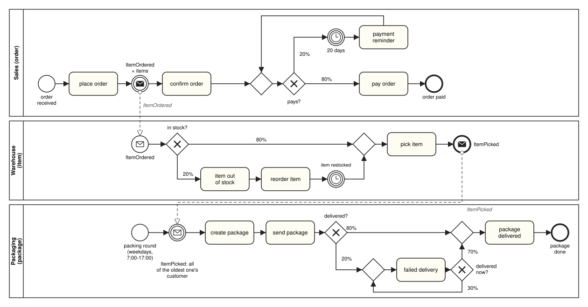
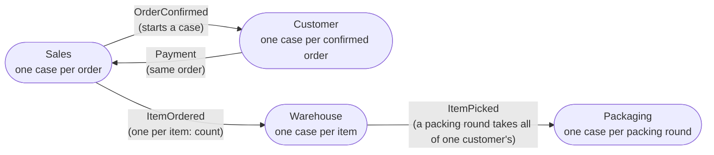

# Order Management example

An example shaped like the OCEL 2.0 **Order Management** log (2,000 orders, 7,659 items, 1,128
packages), to show the multi-process features working together on a realistic model and to compare counts
and shares with the real log. Times are only roughly calibrated. The models are in
`testing_scripts/assets/order_management/`; the tests are in `testing_scripts/test_order_management.py`.

It uses most messaging features ([messaging.md](messaging.md)): one message per object with `count` and
`index`, processes started by messages, `copy`, `append` and `aggregate`, conditions on case attributes, a race
with a timer that repeats, and `collect` with `same`; and the catalogue ([catalogue.md](catalogue.md)) for its
customers and products.

## The processes



```
Sales (order)        arrivals: weekdays 6:00-22:00, about one every 4.3 h, 2,000 orders
                     object attributes: customer (picked from c1..c15), items (1..16, as in the log)
                     place order -> (throw ItemOrdered x items: object_id, index, customer)
                     -> confirm order (Sales) -> (throw OrderConfirmed: object_id)
                     -> race: catch Payment (order_id = object_id) -> pay order -> end
                            | timer 20 days -> payment reminder -> back to the race
Customer             start OrderConfirmed (copy order_id) -> timer (confirm-to-pay delay)
                     -> message end Payment{order_id}
Warehouse (item)     start ItemOrdered (copy order_id, item_index from index, customer)
                     object attributes: product (picked from the log's 20, as often as in the log), and its
                        weight and price
                     -> XOR: 20% item out of stock -> reorder item | 80% straight on
                     -> pick item (Warehousing)
                     -> message end ItemPicked{order_id, item_index, customer, object_id, weight}
Packaging (package)  arrivals: weekdays 7:00-17:00, about one packing round every 2.6 h, 1,200 rounds
                     -> catch ItemPicked: the oldest waiting one and every other of its customer (collect "all",
                        same customer); copy customer, append object_id to item_ids, weight = sum of their weights
                     -> create package (Warehousing) -> send package (Shipment)
                     -> XOR: 22% failed delivery -> back to the XOR | 78% package delivered -> end
```

The customer is picked for the order and travels with the messages: order → `ItemOrdered` → item →
`ItemPicked` → package. Packages are made as in the log: a packing round starts in working hours, takes the
oldest waiting item and then all of that customer's waiting items, and creates the package. If no item is
waiting, the round waits for the next one, and takes it with the others of its customer offered at that
moment. How long an item waits for its package therefore depends on how often rounds come, not on a drawn
package size.

Rounds keep coming after the last item, and would wait forever, so their number is limited: 1,200 rounds last
until a few days after the last order (the orders end on 2024-03-19, the last round starts on 2024-03-22).
With seed 1, the last 6 rounds find no item left; they are still waiting when the run ends, are reported in
`stalled`, and have no package in the OCEL file. With fewer rounds, the last items could be left unpacked instead: 1,194 rounds are just enough for
seed 1, packing every item and leaving no round waiting, but another seed would need a different number.

Not modeled, and where each goes:

- **Confirmation by the customer's primary sales rep** (88% of confirmations in the log; any Sales employee
  confirms here): under discussion.
- **The forwarder of a package** (the shipper sends it here): under discussion.

The Customer process only models how long a customer takes to pay; its rows aren't compared with the log.

## Who talks to whom

Every arrow goes through the orchestrator; processes never address each other. Each process is its own
consumer group, so every message goes to the one process that subscribes to its type.



## Messages

| Process       | Publishes                                                                                 | Consumes                                                                                                                                                                   |
|---------------|-------------------------------------------------------------------------------------------|----------------------------------------------------------------------------------------------------------------------------------------------------------------------------|
| **Sales**     | `ItemOrdered{object_id, index, customer}`, `count` = `items`; `OrderConfirmed{object_id}` | `Payment` where `order_id == object_id`, in a race against the 20-day reminder timer                                                                                       |
| **Customer**  | `Payment{order_id}`, at its message end event                                             | `OrderConfirmed` at its start event; copies `order_id` from `object_id`                                                                                                    |
| **Warehouse** | `ItemPicked{order_id, item_index, customer, object_id, weight}`, at its message end event | `ItemOrdered` at its start event; copies `order_id` from `object_id`, `item_index` from `index`, `customer` from `customer`                                                |
| **Packaging** | nothing                                                                                   | `ItemPicked` at "items picked": `"collect": "all"` with `"same": ["customer"]`, copying `customer`, appending `object_id` to `item_ids` and summing `weight` into `weight` |

## How the log maps to the model

| In the log                     | Process   | BPMN element               | Feature                                                                                                          |
|--------------------------------|-----------|----------------------------|------------------------------------------------------------------------------------------------------------------|
| object type **orders**         | Sales     | one case per order         | arrivals on a weekday calendar; case attribute `items`; `customer` picked from the catalogue                     |
| object type **items**          | Warehouse | one case per item          | a message start event on `ItemOrdered`, published once per item with `count`; `index` → `item_index`             |
| object type **packages**       | Packaging | one case per packing round | arrivals in working hours; `collect` `"all"` with `same` customer; `weight` the sum of its items'                |
| object type **customers**      | all       | case attribute `customer`  | 15 in the catalogue; picked for the order, copied to items and packages; what a package's items share            |
| object type **products**       | Warehouse | case attribute `product`   | the log's 20 in the catalogue; one picked for each item as often as in the log, and its weight and price with it |
| object type **employees**      | all       | resources                  | Sales (5), Warehousing (7, split 5 / 2 between Warehouse and Packaging), Shipment (6)                            |
| activity **place order**       | Sales     | task `Place_Order`         | done by the `Shop` resource; `ItemOrdered` is published right after it                                           |
| activity **confirm order**     | Sales     | task `Confirm_Order`       | Sales; `OrderConfirmed` is published right after it                                                              |
| activity **payment reminder**  | Sales     | task `Payment_Reminder`    | the timer branch of the race (20 days), then back to the race                                                    |
| activity **pay order**         | Sales     | task `Pay_Order`           | after the message branch of the race (`Payment`); done by the `Payments` resource                                |
| activity **item out of stock** | Warehouse | task `Item_Out_Of_Stock`   | the 20% branch of an XOR                                                                                         |
| activity **reorder item**      | Warehouse | task `Reorder_Item`        | after item out of stock                                                                                          |
| activity **pick item**         | Warehouse | task `Pick_Item`           | Warehousing; `ItemPicked` is published at the message end event after it                                         |
| activity **create package**    | Packaging | task `Create_Package`      | after the packing round has taken its items                                                                      |
| activity **send package**      | Packaging | task `Send_Package`        | Shipment                                                                                                         |
| activity **failed delivery**   | Packaging | task `Failed_Delivery`     | the 22% branch of an XOR, then back to it                                                                        |
| activity **package delivered** | Packaging | task `Package_Delivered`   | the 78% branch of that XOR                                                                                       |
| not in the log                 | Customer  | timer `Pay_Delay`          | how long the customer takes to pay; publishes `Payment`                                                          |

## Numbers from the log

| Parameter           | Real log                                                                               | In the model                                                                      |
|---------------------|----------------------------------------------------------------------------------------|-----------------------------------------------------------------------------------|
| Orders              | 2,000; one every 4.26 h on average; 95% on weekdays, mostly 6-22                       | exponential gaps of 2.3 h mean within a weekday 6:00-22:00 calendar               |
| Customers           | 15, 103-152 orders each                                                                | `customer`: picked uniformly from the catalogue's c1..c15                         |
| Items per order     | 1-16 (1: 159, 2: 360, 3: 489, 4: 367, 5: 275, 6: 164, 7: 100, 8+: 86)                  | `items`: these frequencies, 8+ as in the log                                      |
| Out of stock        | 1,544 of 7,659 items (20%)                                                             | XOR 20 / 80                                                                       |
| Confirm to pay      | median 7 days, quartiles 2.34 / 17.86, max 91; 23.5% after 20 days                     | Customer timer: log-normal with that median and quartiles, at most 91 days        |
| Payment reminder    | exactly 20 days after confirm or the previous reminder; 0-4 per order                  | race timer, fixed 20 days                                                         |
| Packing rounds      | 1,128 packages; gaps between create package: median 2.6 h; mostly 7-17                 | exponential gaps of 2.6 h mean within a weekday 7:00-17:00 calendar, 1,200 rounds |
| Items per package   | 1-20, median 6; always one customer: the oldest waiting item and all of its customer's | the same rule: `"collect": "all"` with `"same": ["customer"]`                     |
| Products            | 20, 343-433 items each; weight 0.166-1.48 (an item weighs what its product weighs)     | picked with these frequencies; `with` gives each item its product's weight        |
| Package weight      | the sum of its items' weights                                                          | `"aggregate": {"weight": {"sum": "weight"}}`                                      |
| Failed delivery     | 311 failures in 1,439 attempts (22%); up to 7 per package                              | XOR 22 / 78                                                                       |
| Employees           | Sales 5, Warehousing 7, Shipment 6; weekdays 6-22                                      | the same pools on a weekday 6:00-22:00 calendar (Warehousing split 5 / 2)         |
| Gaps (with waiting) | place→confirm 18 h, place→pick 52 h, create→send 14 h, send→delivered 14 h             | rough task durations; see the comparison                                          |

Place order, pay order and payment reminder have no employee in the log; here they are done by `Shop`
(always available) and `Payments` (weekdays 6-22) resources.

## Running it

```
poetry run prosimos start-orchestration --config testing_scripts/assets/order_management/simulation.json \
    --log_out_path order_management_log.csv --ocel_out_path order_management_log.json
poetry run python testing_scripts/order_management_compare.py <path to order-management.json> order_management_log.json
```

The configuration names the object types in the singular, one kind of thing each: `order` (Sales), `item`
(Warehouse) and `package` (Packaging), and the catalogue adds `customer` and `product`; objects are named
`<object type>-<number>`, e.g. `order-7`. The comparison script reads them under the real log's plural names
(`order` as `orders`). Customer has no object type, so the OCEL file has no objects or events for it. Each event
is linked to the objects on the other end of its messages ([orchestrator.md](orchestrator.md), "One event linked
to many objects"), as the Order Management log links them. Like the log, only one end of the messages between
the items and the others links: `ItemOrdered` from the order's place order, `ItemPicked` from the package's
create package; the Warehouse's entries have no qualifier, so the item's events link neither its order nor its
package. With `"tag_along": true` on the product reference, every event that links an item also links its
product (`product`), as in the log; customers don't tag along, so pay order links no customer:

| Event                                            | Linked to                                                                                                              |
|--------------------------------------------------|------------------------------------------------------------------------------------------------------------------------|
| place order                                      | its order (`order`), the items its ItemOrdered messages started (`item`), their products and its customer (`customer`) |
| confirm order                                    | its order, its customer and, with `carry_links`, its items and their products                                          |
| payment reminder, pay order                      | its order and, with `carry_links`, its items and their products                                                        |
| every event of an item                           | its item (`item`) and its product (`product`), from the reference that picks it; not its order or its package          |
| create package                                   | its package (`creates`), the items it collected (`item`) and their products                                            |
| send package, failed delivery, package delivered | its package (`shipped package`) and, with `carry_links`, its items and their products                                  |

Objects are linked to each other too: each order **comprises** its items (`"o2o": "comprises"` on Sales's
ItemOrdered entry), each package **contains** its items (`"o2o": "contains"` on Packaging's ItemPicked entry),
and each item **is a** product (`"o2o": "is a"` on the product reference).

Customers have no events of their own, so they come from a catalogue of Sales: 15 customers, c1 to c15, each
with a `segment` ([catalogue.md](catalogue.md) uses this configuration as its worked example). A reference of
Sales on its `customer` attribute picks it when an order is created (`"pick": "uniform"`; `sales.json` doesn't
draw it), links each customer to the orders it **places** (`"reverse": true`, from the customer to the order),
and links place order and confirm order to their customer; pay order isn't linked. Since `ItemOrdered` carries
the picked `customer`, `sales.json` only runs inside this configuration, not on its own. Products come from a
catalogue of the Warehouse: the log's 20, each with its `weight` and first `price`. A reference of the Warehouse
picks one for each item, with the number of items of each product in the log as weights, links the item to it
(**is a**), links every event of the item to it and, with `"tag_along": true`, every other event that links the
item, and, with `"with": ["weight", "price"]`, gives the item its product's weight and price when it is created.
They are the item's own attributes from then on: written on its OCEL object (the Warehouse's `ocel_attributes`),
and `weight` travels on `ItemPicked` to be summed into the package's.

Only the attributes the log has are written to the objects (`ocel_attributes`): an item's `weight` and `price`
and a package's `weight`. The others route messages (`order_id`, `item_index`, `item_ids`, `items`) or are links
already (`customer`, `product`), and stay in the CSV log only. A packing round takes all its items at the same
moment, so its package gets one weight, the sum of its items', as in the log, without the running totals in
between or the starting 0.

Sales and Packaging have `carry_links`; Warehouse doesn't, so a reorder is linked only to its item and its
product. A packing round that never took an item has no events and no links, so the OCEL file leaves its package
out; the run report still lists it as stalled. The full 2,000-order run takes about 21 seconds (Apple M4 Pro).

The comparison script reads the real log and the simulated OCEL file the same way, from their objects,
events and links. It counts object-to-object links from the files themselves, since pm4py leaves out objects
that no event refers to.

## Comparison with the log

2,000 orders, seed 1; real log against the simulated OCEL file, both read by the comparison script.

| Metric                                                              |                       Real log |                      Simulated |
|---------------------------------------------------------------------|-------------------------------:|-------------------------------:|
| orders                                                              |                          2,000 |                          2,000 |
| items                                                               |                          7,659 |                          7,735 |
| packages                                                            |                          1,128 |                          1,194 |
| customers / products                                                |                        15 / 20 |                        15 / 20 |
| items per order: mean / median / max                                |                  3.83 / 3 / 16 |                  3.87 / 3 / 16 |
| items per order: 1 / 2 / 3 / 4                                      |      8.0 / 18.0 / 24.4 / 18.4% |      8.1 / 17.4 / 24.9 / 17.8% |
| items per order: 5 / 6 / 7 / 8+                                     |        13.8 / 8.2 / 5.0 / 4.3% |        13.8 / 7.8 / 5.5 / 5.0% |
| reminders per order: mean / max                                     |                       0.28 / 4 |                       0.32 / 4 |
| reminders per order: 0 / 1 / 2 / 3 / 4+                             | 77.8 / 17.2 / 3.9 / 0.9 / 0.1% | 80.0 / 12.4 / 4.2 / 2.4 / 0.9% |
| orders paid after 20 days                                           |                          23.5% |                          20.2% |
| items out of stock                                                  |                          20.2% |                          19.7% |
| items per package: mean / median / max                              |                  6.79 / 6 / 20 |                6.48 / 5.5 / 30 |
| customers per package                                               |                       always 1 |                       always 1 |
| packages per customer: mean / median / max                          |                 75.2 / 76 / 80 |                 79.6 / 79 / 90 |
| failed deliveries per package: mean / max                           |                       0.28 / 7 |                       0.27 / 4 |
| failed deliveries per package: 0 / 1 / 2 / 3+                       |       81.0 / 13.2 / 4.0 / 1.8% |       79.3 / 15.6 / 4.1 / 1.0% |
| items per event: place order / create package / send package (mean) |             3.83 / 6.79 / 6.79 |             3.87 / 6.48 / 6.48 |
| links: customers places orders                                      |                          2,000 |                          2,000 |
| links: orders comprises items                                       |                          7,659 |                          7,735 |
| links: packages contains items                                      |                          7,659 |                          7,735 |
| links: items is a products                                          |                          7,659 |                          7,735 |
| links to employees (sales reps, packer, forwarder, shipper)         |                          3,414 |                              - |
| pick item to create package: quartiles (h)                          |             22.0 / 46.0 / 79.6 |             20.7 / 38.5 / 68.8 |
| pick item to create package: mean (h)                               |                           56.4 |                           45.6 |
| items picked before their order is confirmed                        |                          25.4% |                          60.7% |
| orders paid after their first delivery                              |                          67.3% |                          69.8% |

The counts and shares that come from the model's structure and parameters (items per order, out of stock,
customers per package, failed deliveries, the links between objects) match closely. Packages now come from the
log's packing rule rather than a drawn size: with rounds about as frequent as in the log, there are 6% more
packages, slightly smaller on average (6.48 items against 6.79), but up to 30 items when a customer's items
pile up between rounds. With more rounds, items also wait a little less for their package than in the log
(median 38.5 h against 46 h). The fitted confirm-to-pay distribution pays a little earlier than the log, but has a longer tail, so more
orders get 3 or 4 reminders. The largest difference is in timing: in the log, items wait about two days before
they are picked (place→pick 52 h), which the model doesn't reproduce (about 11 h), so far more items are picked
before their order is confirmed. The log links packages and confirmations to employees; here employees are
resources, not objects.

## Gaps found

Found while building the example; no feature was added for them.

- **`index` can't be passed on.** `index` is reserved for `count` in publish entries, so an item can't
  publish its own number under that name. The Warehouse keeps it as `item_index` instead.
- **Resources aren't shared between processes.** Picking (Warehouse) and packing (Packaging) are done by the
  same 7 Warehousing employees in the log, but each Prosimos process has its own resource pool; they are
  split 5 / 2 here. Under discussion.
- **A process started by arrivals has no end time.** The packing rounds are limited by their number, 1,200,
  chosen so that they last until just after the orders; how many are left waiting at the end, or how many items
  are left unpacked with fewer rounds, depends on the seed.
- **Reminders are 20 days and one microsecond apart.** A race timer's branch continues one microsecond after
  the timer's time, so that a message at exactly that time wins ([messaging.md](messaging.md)). By design.
