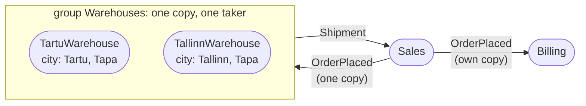

# Running example: orders, invoices and shipments

One scenario, used throughout this documentation and in the tests, that shows how processes
exchange messages through the orchestrator ([orchestrator.md](orchestrator.md)): orders placed in
Sales are billed, packed by one of two warehouses, shipped, and closed. All four processes are real
Prosimos models in `testing_scripts/assets/running_example/`, run from one configuration file,
`simulation.json` (checked by `testing_scripts/test_real_running_example.py`).

A larger example, after a real event log and with a comparison against it, is the
[Order Management example](order-management.md).

## The scenario

### Processes and messages

| Process              | Its cases  | Publishes                                      | Consumes                                                          |
|----------------------|------------|------------------------------------------------|-------------------------------------------------------------------|
| **Sales**            | `order`    | `OrderPlaced{object_id, city}`                 | `Shipment` where `order_id = object_id`                           |
| **Billing**          | `invoice`  | nothing                                        | every `OrderPlaced`, at its start event                           |
| **TartuWarehouse**   | `shipment` | `Shipment{order_id}`, once the order is packed | `OrderPlaced` where `city` is Tartu or Tapa, at its start event   |
| **TallinnWarehouse** | `shipment` | `Shipment{order_id}`, once the order is packed | `OrderPlaced` where `city` is Tallinn or Tapa, at its start event |

```
Sales:             start -> Place order -> throw OrderPlaced{object_id, city}
                   -> catch Shipment (order_id = object_id) -> Close order -> end
Billing:           message start OrderPlaced (any), copy order_id <- object_id -> Create invoice -> end
TartuWarehouse:    message start OrderPlaced (city Tartu or Tapa), copy order_id <- object_id
                   -> Pack order (1 h) -> message end Shipment{order_id}
TallinnWarehouse:  the same for Tallinn or Tapa, Pack order 1.5 h

consumer_groups:   Sales: [Sales]   Billing: [Billing]   Warehouses: [TartuWarehouse, TallinnWarehouse]
```

Orders arrive about every 30 minutes (`arrivals: 20`), each with a `city` drawn by Prosimos: Tartu
40%, Tallinn 30%, Tapa 20%, Pärnu 10%. Only Sales has an arrival schedule; the other three are
started by `OrderPlaced` messages, so they have no `arrivals` and no arrival settings. Billing and
the warehouses copy the order's `object_id` into `order_id`, so the merged log shows which order each
of their cases belongs to, and a warehouse's `Shipment` carries it back to Sales.

### Who talks to whom

Every arrow goes through the orchestrator; processes never address each other.



Billing is a group of its own, so it gets its own copy of every order. The two warehouses share one
group: each order is offered to both, and the first that accepts it takes it. A Tapa order suits
both, so which one packs it is a random choice of the orchestrator, fixed by the seed. A Pärnu order
suits neither: both discard it, and its Sales case waits for a shipment that never comes.

## Running it

From the command line (the [Quick start](orchestrator.md#quick-start) shows the configuration):

```
poetry run prosimos start-orchestration --config testing_scripts/assets/running_example/simulation.json --log_out_path merged_log.csv --ocel_out_path running_example.json
```

or from Python:

```python
from prosimos.orchestration.config import SimulationConfig
from prosimos.orchestration.simulation import run_multiprocess_simulation

config = SimulationConfig.from_json("testing_scripts/assets/running_example/simulation.json")
report = run_multiprocess_simulation(config, log_out_path="merged_log.csv", ocel_out_path="running_example.json")
```

## What a run shows

For seed 1 and 20 orders (8 Tartu, 2 Tallinn, 7 Tapa, 3 Pärnu):

| Process          | Cases                                                                                                         |
|------------------|---------------------------------------------------------------------------------------------------------------|
| Sales            | 20 orders; 17 closed, each after its shipment; the 3 Pärnu orders wait forever and are the only stalled cases |
| Billing          | 20 invoices, one per order, Pärnu included                                                                    |
| TartuWarehouse   | 12 cases: the 8 Tartu orders and 4 of the Tapa orders                                                         |
| TallinnWarehouse | 5 cases: the 2 Tallinn orders and the other 3 Tapa orders                                                     |

Every order from Tartu, Tallinn or Tapa has exactly one warehouse case, in a warehouse that serves its
city, and is closed after its shipment. There are no warnings and no unclaimed messages, and the same
seed gives the same run.

### The OCEL output

Each process names the type of the objects its cases are, in the singular: `order` (Sales), `invoice`
(Billing) and `shipment` (both warehouses, which make the same kind of thing). The two warehouses each
number their own shipments from `shipment-0`, as the run report and the messages show them; the OCEL
output numbers them across both, in the order they were created, so its 17 shipments are `shipment-0` to
`shipment-16` ([orchestrator.md](orchestrator.md), "Output"). For seed 1 the file has 57 objects (20
orders, 20 invoices, 17 shipments) and 74 events, one per task.

Each `OrderPlaced` a case starts from links it to its order: an invoice `bills` the order, and Create
invoice links it as the `billed order`; a shipment `ships` it, and Pack order links it as the `packed
order`. Sales's `Shipment` entry links Close order to the shipment that ships the order, as the
`received shipment`. Sales's own `OrderPlaced` entry has no qualifier, so Place order links only its
order.
