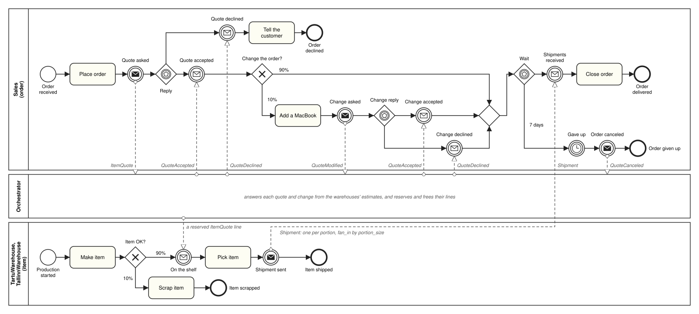
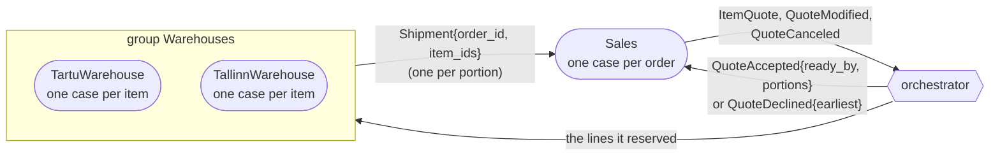

# Stock Reservation example

An example of quotes: Sales asks for the products of each order, and the orchestrator promises them, from items the
two warehouses have on the shelf or are making, within the order's own patience, or declines. The warehouses hold
the items they promised and ship each order's portion as one message. The models are in
`testing_scripts/assets/stock_reservation/`; the test of the base run is
`testing_scripts/multiprocess/examples/test_stock_reservation.py`.

The other examples are the [Order Routing example](order-routing.md), with orders, invoices and shipments, and the
[Order Management example](order-management.md), with orders, items and packages.

## The processes



```
Sales (order)        arrivals: about one every 2 h, around the clock, 20 orders
                     object attributes: items (1, 2 or 3), patience (1 to 5 days), products (picked from the
                     catalogue, one per item: iPhone 2 : iPad 2 : MacBook 1), addition (one MacBook)
                     Place order (clerk, 10 min)
                     -> throw Quote asked: ItemQuote, a line per product, within patience days
                     -> race: Quote accepted (copy portions)
                            | Quote declined -> Tell the customer (clerk, 5 min) -> end
                     -> XOR: 90% straight on | 10% Add a MacBook (clerk, 5 min; products = products + addition)
                            -> throw Change asked: QuoteModified
                            -> race: Change accepted (copy portions) | Change declined
                     -> race: Shipments received (collect as many Shipments as portions)
                              -> Close order (clerk, 5 min) -> end
                            | timer 7 days: Gave up -> throw Order canceled: QuoteCanceled -> end
TartuWarehouse       arrivals: one every 2 h, 30 items; product picked when the item is created
(item)               (iPhone 3 : iPad 2 : MacBook 1)
                     Make item (maker, 1 h)
                     -> XOR: 10% Scrap item (picker, 10 min) -> end
                           | 90% catch On the shelf: a line of an ItemQuote for its product (copy order_id,
                             portion_size) -> Pick item (picker, 15 min)
                             -> throw Shipment sent: Shipment{order_id, item_ids}, fan_in by portion_size -> end
TallinnWarehouse     the same model, one item every 3 h, 20 items (iPhone 1 : iPad 2 : MacBook 2)
(item)
```

Sales has two clerks; each warehouse has one maker and two pickers. Everyone works around the clock, and every
duration is fixed. The two warehouses share one model, `warehouse.bpmn`; their JSON files differ only in how often
an item arrives. Both make items until 20:00 on day 3, 33 hours after the last order.

## Who talks to whom

Every arrow goes through the orchestrator; processes never address each other. The two warehouses form the
consumer group Warehouses, which answers Sales's quotes.



## How a quote is answered

When Sales asks a quote, the orchestrator asks both warehouses when each could have each line ready: an item of
the line's product, on the shelf now, being made, or still to be made, not promised yet. Prosimos plans every
case's arrival, and draws its attributes, when the run starts, so a warehouse knows each item it will make and its
product from then on. An item that may still be scrapped counts by its chance, 90%, until it is inspected, though
Prosimos draws the outcome when Make item starts. Each line takes the soonest such item across both warehouses, so
an order's lines may be split over both. If every line can be ready within the order's patience, the quote is
accepted: each line is reserved at its warehouse, and the reply carries `ready_by`, when the last line will be ready,
and `portions`, how many warehouses have a part of the order. Otherwise it is declined, with `earliest`, when every
line could be ready, or without one when some line has no item left to promise.

A warehouse holds the items it promised: an item that reaches the shelf takes the oldest open line of its product,
and waits until every line of its order's portion there is taken. Then the portion's items move on together, each
with `portion_size`, the number of items in the portion, and `fan_in` sends them as one Shipment. Sales collects as
many Shipments as it has portions.

A change (Add a MacBook) is a QuoteModified: accepted, the lines already reserved keep their place and the new ones
are added, with a new `ready_by`; declined, the order keeps what it had. Once a portion has moved on, the quote is
locked, and a change is declined. An order that gives up after 7 days cancels its quote, which frees its lines
unless a portion has already moved on: then the cancel is too late, and what is left still ships. An order that
ends without canceling, after delivery or after a decline, cancels its quote automatically; by then nothing is left
to free.

## The base run

With seed 1, 16 of the 20 orders are accepted and 4 declined; of the two changes, one is accepted and one declined.
The run already tells these stories, which the test checks with their times:

| Story                             | Order    | What happens                                                                                                                                                                                            |
|-----------------------------------|----------|---------------------------------------------------------------------------------------------------------------------------------------------------------------------------------------------------------|
| a quote split over two warehouses | order-0  | asks two MacBooks and an iPad at 09:10; accepted at once, ready by 19:00, in 2 portions: Tartu ships the iPad at 10:15, Tallinn both MacBooks in one Shipment at 13:15; Sales closes the order at 13:20 |
| declined with an earliest         | order-8  | patient for 1 day, asks two MacBooks and an iPad at 01:36 on day 2; they could be ready at 14:00 the next day, past its limit: declined, and the customer is told                                       |
| declined without an earliest      | order-13 | and orders 14 and 18: every item of one of their products that the warehouses will make is promised already                                                                                             |
| a change accepted                 | order-6  | asks an iPad at 15:17, ready just after midnight; adds a MacBook, accepted for 12:00 on day 3; the iPad, on the shelf from 20:00, keeps its line and ships with the MacBook at 08:15 on day 3           |
| a change declined                 | order-9  | its iPad is on the shelf when it asks, so it moves on at once; the MacBook it adds 5 minutes later is declined, since the quote is locked, and the iPad ships                                           |
| an order that gives up, too late  | order-10 | accepted for a MacBook and an iPad, ready by 13:00 on day 3, split: Tartu's iPad moves on at once; Tallinn's MacBook is scrapped, and Tallinn makes no other; after 7 days the order cancels, too late  |

order-10's Tallinn portion is the run's one broken promise: undelivered, overdue by 5 days and 15 hours when the run
ends with the order's give-up. 10 items, made after the last order, are still on the shelves then.

## Running it

```
poetry run prosimos start-orchestration --config testing_scripts/assets/stock_reservation/simulation.json \
    --log_out_path stock_reservation_log.csv --ocel_out_path stock_reservation_log.json \
    --report_out_path stock_reservation_report.json
```

The run report counts the quotes' outcomes (`quotes`) and the broken promises (`broken_promises`), next to the
messages and the stalled cases ([orchestrator.md](orchestrator.md), "Output").

The object types are `order` (Sales), `item` (both warehouses: one numbering in the OCEL file, so Tartu's and
Tallinn's items get ids of their own) and `product`, from Shop's catalogue. Four message ends have a qualifier, so
they write events of their own ([orchestrator.md](orchestrator.md), "One event linked to many objects"):

| Event              | Linked to                                                                                    |
|--------------------|----------------------------------------------------------------------------------------------|
| Quote asked        | its order and the items that took its lines (`requests`)                                     |
| On the shelf       | its item, its product, and the order whose line it took (`reserved for`)                     |
| Shipment sent      | its item, its product, and its order (`shipped in`), one per item                            |
| Shipments received | its order and the items of the Shipments it took then (`received shipment`), one per moment |

Each Shipment received is an event of its own, so an order that gives up after some of its Shipments still shows the
ones it got, without a task for them.
